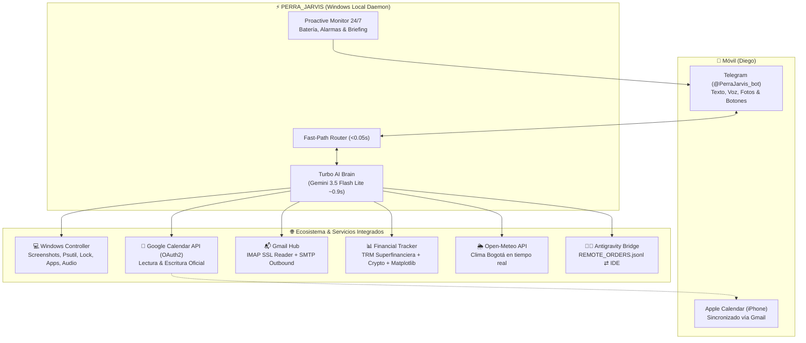

# 🤖 PERRA_JARVIS — Executive Personal AI Assistant

[](https://python.org)
[](https://microsoft.com)
[](https://telegram.org)
[](https://aistudio.google.com)
[](https://azure.microsoft.com)
[](LICENSE)

> **Asistente personal ejecutivo autónomo tipo Jarvis, 100% en tu bolsillo vía Telegram, con control operativo directo sobre tu computador Windows, sincronización bidireccional con Google Calendar & iPhone, despacho de correos en Gmail, puente a tus entornos de desarrollo y estricta política de costo $0.00 USD.**

---

## 🌟 Arquitectura General del Sistema



---

## 🦾 Módulos y Capacidades de Primer Nivel

### 1. 💻 Control Total de tu PC (Windows)
- 📸 **Captura de Pantalla en Vivo:** Integración GDI con `user32.OpenInputDesktop` para capturas limpias incluso en sesiones en segundo plano.
- 🔋 **Telemetría de Hardware:** Monitoreo en tiempo real de batería (% y estado de carga AC), uso de CPU, memoria RAM y almacenamiento.
- 🔒 **Modo Centinela / Bloqueo:** Bloqueo de sesión Windows inmediato (`LockWorkStation`) con un toque desde el celular.
- 🚀 **Lanzador de Apps:** "Abre Spotify", "Abre Chrome", "Abre VS Code".
- 🔊 **Control Multimedia:** Subir/bajar volumen, silenciar (Mute) y reproducir/pausar canciones.
- 📁 **Explorador de Descargas:** Inspección remota de archivos recientes descargados.

### 2. 📅 Calendario Oficial: Google Calendar API ⇄ iPhone Sync
- **OAuth2 Bidireccional:** Conexión oficial autorizada con la **Google Calendar API v3** (`token.json`).
- **Agendamiento Manos Libres:** Agendamiento por texto o nota de voz (*"Agéndame entrega del lab de ARSW el viernes a las 11:59 pm"*).
- **Reflejo Inmediato en iPhone:** Como el iPhone sincroniza la cuenta de Gmail, el evento entra de inmediato en la app oficial de Calendario de iOS.
- **Doble Alerta:** Generación automática de alarmas sonoras en Telegram para el minuto exacto del evento.
- **Soporte Híbrido iCloud:** Fusión transparente con calendarios Webcal de Apple (Casa / Trabajo).

### 3. 📧 Centro de Operaciones Gmail (Lectura & Envío)
- **Lectura IMAP SSL:** Consulta rápida de los correos no leídos más recientes.
- **Despacho Outbound SMTP:** Envío formal de correos directamente desde Telegram (*"Manda un correo al profesor con asunto Entrega y dile que adjunto el enlace..."*).
- **Redacción Inteligente con IA:** Gemini Flash Lite estructura el saludo, cuerpo profesional y firma.

### 4. ⚡ Cerebro Inteligente Híbrido (Fast-Path + Gemini Flash Lite)
- **Fast-Path Router (<0.05s):** Resuelve acciones comunes (pantalla, menú, batería, TRM, clima, volumen) localmente sin llamadas a la nube.
- **Gemini 3.5 Flash Lite (~0.99s):** Comprensión profunda, notas de voz (`.ogg`), fotos (visión multimodal) y Function Calling autónomo.
- **Audio Nativo:** Escucha audios de Telegram y responde ejecutando la orden solicitada.

### 5. 🛡️ Monitor Proactivo en Segundo Plano
- **Alerta de Carga Completa:** Notificación push sonora cuando la laptop alcanza el 100% para cuidar los ciclos de batería.
- **Alerta Crítica de Batería:** Aviso urgente si la batería baja de 20% y el cargador está desconectado.
- **Briefing Ejecutivo Matutino (`/briefing`):** Consolidado diario que agrupa Clima de Bogotá, TRM del día, estado de batería, correos pendientes y eventos de la jornada.

### 6. 📊 Finanzas & Mercados en Tiempo Real
- 🏛️ **TRM Oficial USD/COP:** Datos abiertos en tiempo real de la Superintendencia Financiera de Colombia (`datos.gov.co`).
- 💎 **Criptomonedas:** Cotizaciones 24h de Bitcoin, Ethereum y Solana vía CoinGecko.
- 📈 **Gráficas Visuales Dark Mode:** Generación de gráficos históricos en formato PNG generados en local con `matplotlib`.

### 7. 🧑‍💻 Puente Antigravity (IDE Remoto)
- Permite seleccionar cualquier repositorio de tu computador (`PERRA_JARVIS`, `ARSW`, `PTIA`, `LAB_6`) y enviarle instrucciones al agente de código local a través de `REMOTE_ORDERS.jsonl` y `REMOTE_RESULTS.jsonl`.

### 8. 🧪 Ejecutor Remoto de Pruebas Unitarias (Test Runner con IA)
- **Ejecución Multi-Ecosistema:** Ejecuta suites de tests automáticas en tus proyectos (Maven Java con `mvnw.cmd`, Node.js con `npm test`, Python con `unittest`/`pytest`).
- **Diagnóstico Autónomo:** Si una prueba falla, Gemini Flash Lite analiza la traza del error en segundos, localiza la línea exacta rota y te explica la solución técnica en tu Telegram.

### 9. 📑 Analizador de Documentos y PDFs Multimodal
- **Estudio y Parciales:** Reenvíale cualquier archivo PDF, diapositiva o documento de clase al bot.
- **Consultas con Caption:** Si le agregas un comentario (*"Hazme un resumen de 5 puntos"* o *"Saca 3 preguntas tipo parcial"*), la IA lo procesa y te responde estructurado.

### 10. 🐙 Agente Git & GitHub
- Inspección rápida de cualquier repositorio: rama activa, archivos pendientes sin commit y los últimos commits realizados.
- Ejecución segura de commits y push directamente desde Telegram.

### 11. 🗣️ Respuestas con Voz Sintetizada Ultrarrealista
- **Síntesis Neuronal (Edge-TTS):** Jarvis ahora no solo te escribe, ¡te habla!
- Cuando le envíes una nota de voz o le digas *"háblame"*, te responderá con una nota de voz en español colombiano neutro de alta fidelidad sin ningún costo ($0.00).

---

## 📂 Estructura del Repositorio

```
PERRA_JARVIS/
├── .env.example              # Plantilla de configuración de entorno
├── .gitignore                # Reglas estrictas de privacidad (ignora tokens, credenciales y logs)
├── config.py                 # Validador y cargador central de configuración
├── main.py                   # Orquestador del bot asíncrono y monitor proactivo
├── requirements.txt          # Dependencias oficiales verificadas
├── azure/                    # Paquete de contingencia serverless ($0.00)
│   ├── function_app.py       # Azure Function de relevo en la nube
│   ├── host.json             # Runtime configuration
│   └── README_AZURE.md       # Guía de despliegue en Azure Consumption Tier
├── modules/
│   ├── ai_brain.py           # Fast-Path Router + Gemini 3.5 Flash Lite Function Calling
│   ├── calendar_hub.py       # Google Calendar API (OAuth2) + iCloud Webcal Fusion
│   ├── email_hub.py          # Gmail IMAP SSL Reader + SMTP Outbound Dispatcher
│   ├── pc_controller.py      # Win32 GDI screen grab, psutil, process launcher, media keys
│   ├── market_tracker.py     # TRM Colombia, Crypto tracker y Dark-Mode charts
│   ├── weather_service.py    # Open-Meteo Bogotá en tiempo real
│   ├── reminder_service.py   # Motor local de recordatorios con parseo de tiempo
│   ├── proactive_monitor.py  # Centinela de batería, agenda y Daily Briefing
│   ├── antigravity_bridge.py # Interfaz de comunicación con workspaces de código
│   ├── remote_test_runner.py # Ejecutor de pruebas Maven/Node/Python con diagnóstico IA
│   ├── document_analyzer.py  # Procesador multimodal de PDFs y documentos
│   ├── git_agent.py          # Agente Git para inspección y commits remotos
│   ├── voice_engine.py       # Síntesis de voz natural en español con Edge-TTS
│   └── telegram_ui.py        # Dashboard modular, Inline Keyboards y despachador
└── scripts/
    ├── auth_google_calendar.py # Flujo OAuth2 interactivo de Google Calendar
    ├── run.bat               # Ejecución interactiva en consola
    ├── start_hidden.vbs      # Lanzador silencioso en segundo plano
    └── stop_jarvis.bat       # Detención limpia de procesos
```

---

## 🚀 Puesta en Marcha

### 1. Clonar e Instalar Dependencias
```bash
git clone https://github.com/DiegoFabianAndrade/PERRA_JARVIS.git
cd PERRA_JARVIS
pip install -r requirements.txt
```

### 2. Configurar Variables de Entorno (`.env`)
Crea tu archivo `.env` basándote en `.env.example`:
```ini
TELEGRAM_BOT_TOKEN=tu_token_de_telegram
ALLOWED_CHAT_ID=1257398092
GEMINI_API_KEY=tu_api_key_de_google_ai_studio
ASSISTANT_NAME=PERRA_JARVIS
DEBUG=False

# Gmail Oficial (Lectura IMAP + Envío SMTP)
GMAIL_USER=tu_correo@gmail.com
GMAIL_APP_PASSWORD=xxxx xxxx xxxx xxxx

# Calendarios
ICLOUD_CALENDAR_URL=webcal://pXX-caldav.icloud.com/...
```

### 3. Vincular Google Calendar (Opcional, 1 sola vez)
```bash
python scripts/auth_google_calendar.py
```
Se abrirá el navegador para autorizar la app y generará `token.json` automáticamente.

### 4. Iniciar Jarvis
- **Modo interactivo (consola):**
  ```bash
  python main.py
  ```
- **Modo silencioso 24/7 (segundo plano invisible):**  
  Doble clic en `scripts/start_hidden.vbs`.

---

## 🔒 Seguridad y Privacidad
- **Whitelist Estricta:** El bot solo responde al `ALLOWED_CHAT_ID` autorizado. Cualquier interacción no autorizada es rechazada.
- **Cero Filtraciones:** Archivos críticos (`.env`, `token.json`, `credentials.json`, `REMOTE_ORDERS.jsonl`) están estrictamente ignorados por Git.
- **Costo Cloud $0.00:** Corre 100% en infraestructura local y servicios gratuitos sin comprometer saldos ni tarjetas.
